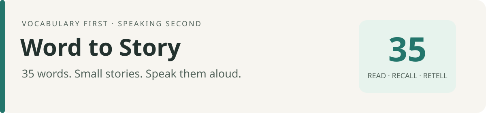

# Word to Story · 背词＋口语



**顺序取35词，写成能读、能背、能复述的故事和对话。**

背词是主目标，口语是同一份材料上的延伸练习。Agent负责创作和审读；Python负责取词、检查、排版和进度。项目通过入口文档引导Agent执行，可以放入Codex Cloud按需使用。

[内容要求](docs/CONTENT_RULES.md) · [Agent操作手册](docs/AGENT_RUNBOOK.md) · [云端使用](docs/CLOUD.md)

## 输出长什么样

每批1—4篇，默认4篇；每篇完整放在一张1080×1920竖图上。正文高亮目标词并标注原编号，下面有本文用义、正文词块、一条语法提示、复述线索和个人改写句。


手机端默认全部直接看图，按组展示：**朗读背词4张 → 遮词回忆4张 → 单词抽查2张 → 对照答案2张**。每组先说明用途和张数，每张独立显示；图内也标有组别和页码。抽查页数按实际排版变化，答案始终放最后。公开示例沿用332—366词最后确认的正文，原完整故事卡不拆页。

## 先复现一次

需要Python 3.11或以上。字体采用开源Noto字体，下载源固定到提交和SHA-256，不依赖Windows字体。

```bash
python -m pip install -r requirements.txt
python -m wordstory fonts
python -m wordstory demo
```

命令输出成品目录和分组计数。`delivery.json`规定图片分组、顺序和题号；示例共12张1080×1920竖图。Agent按此顺序把全部图片直接展示在聊天里，学习者无需下载文件。Markdown/CSV/JSON/ZIP仅作后台与备份，默认不附，用户索要时再提供。demo使用独立测试数据，不推进正式进度，不调用文字模型API；样例文字来自仓库中的原创练习。

默认数据目录：Windows为用户指定的D盘Codex数据目录下的独立文件夹；Linux/macOS为项目下被Git忽略的 `data/`。可用 `--data "<目录>"` 或环境变量 `WORDSTORY_DATA_DIR` 指定。个人词表和进度不属于公开源代码。

## 让Agent生成新内容

把自己的编号CSV导入一次：

```bash
python -m wordstory init --vocab "<你的词表.csv>" --start 332 --data "<个人数据目录>"
```

然后对能访问本项目和个人数据的Agent说：

> 阅读AGENTS.md，按CONTENT_RULES最后确认版生成下一批35词。先检查进度，写出完整内容，再执行校验和排版，查看全部图片后保存结果。背词优先，口语辅助。不要自动发送微信。

第一次测试或重写时说：

> 继续用332—366这35词测试，保持最后确认的要求，不推进正式进度。

完整步骤见[操作手册](docs/AGENT_RUNBOOK.md)。正文由Agent现场写入 `content.json`，不需要额外接一套文本API；纯Python命令不会自动创作新故事。需要支持读文件、写文件、执行命令和查看图片的Agent环境。

## 保持哪些要求

- 35词来自同一份原编号词表，按顺序走；目标词全部覆盖，其他词尽量简单。
- 内容贴近雅思生活话题，句式联系考研常见语法，适合朗读，避免为凑词硬造句。
- 词块和语法例句都出自正文；有遮词回忆、复述和个人改写任务。
- 大字、竖版9:16、一篇一张；溢出就改内容，不自动缩字或拆页。
- 所有学习内容均交付图片；分组编号、单张顺序展示，适配手机竖屏，不要求打开文件。
- 测试和重写不推进。正式新批次只在成品检查完成后推进，失败不前进，重试不重复计数。

细节以[最终内容要求](docs/CONTENT_RULES.md)为准。程序检查客观条件；简单程度、自然度与搭配仍需要Agent审读和人的反馈。进度表示“材料已生成”，不代表“已背会”。

## 项目结构

```text
AGENTS.md                 Agent入口与执行边界
docs/CONTENT_RULES.md      最后确认的内容要求
docs/AGENT_RUNBOOK.md      完整执行步骤
docs/CLOUD.md             云端环境和私有数据交接
wordstory/                取词、校验、排版、备份与进度
examples/                 35词和最后确认的原创内容样例
assets/fonts/             字体来源、校验值和许可证
tests/                    内容与进度故障测试
scripts/                  公开文件检查
```

运行后的完整词表、进度、正文和图片存放在个人数据目录。红宝书原PDF及完整提取词表不随公开仓库分发；可自行导入，PDF导入需额外安装 `requirements-pdf.txt`。

## 云端与后续

先把项目接入Codex Cloud，恢复一份私有进度备份，即可在同一云端对话里按需生成。新任务的工作区与其他任务分开，跨任务需要恢复最新备份；当前没有跨任务自动同步的数据库。

本项目没有后台常驻服务、定时调度或微信投递。官方云端环境的可用能力以当前账户为准；生成图片不等于已发到微信。[云端设置与首次测试](docs/CLOUD.md)

## 验证与许可

```bash
python -m unittest discover -s tests -v
python scripts/check_public_files.py --worktree
git diff --check
```

代码和原创示例使用[MIT License](LICENSE)。字体采用SIL Open Font License，来源及许可证见 `assets/fonts/`。用户导入的材料与个人数据不包含在本项目的许可范围内。
